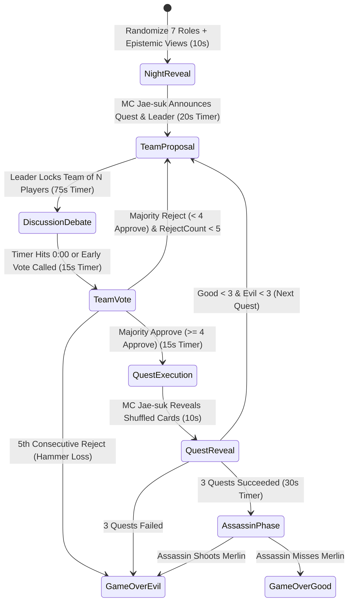

# Core Specification (`spec-core.md`) — IDOL AVALON: Live Variety Show Social Deduction

## 1. Product Vision & Hackathon Track Alignment
- **Title**: **IDOL AVALON: Live K-Pop Variety Show Social Deduction**
- **Track**: **Track 1 — Gemini 4 Argon in Entertainment**
- **Core Concept**: A single-player, live-generated social deduction game following the **exact 7-player rules of *The Resistance: Avalon***, staged as a high-energy **K-Pop Idol Variety Show Zoom Call**.
- **Cast**:
  - **1 Non-Playing Variety Show Host (진행자)**: **MC Jae-suk** (inspired by National MC Yoo Jae-suk — signature glasses, sharp suit, cue cards, witty and energetic variety host who runs the game clock, announces phases/votes/quests, and roasts silent bystanders).
  - **6 Photorealistic AI K-Pop Girl Group Idols**: **Wonyoung, Karina, Sullyoon, Yuna, Chaewon, Hanni** (all-star visual & personality line-up with realistic webcam feeds, live LLM reasoning, live voice speech, and generative video reactions).
  - **1 Human Player ("Guest / 7th Member")**: Joins via text chat or live voice microphone (or can choose to stay completely silent as a bystander while the AI idols autonomously run and play the entire game).
- **Language Policy**: **100% English** for all UI labels, game system logs, subtitles, MC commentary, and Idol dialogue/speech (with natural K-Pop variety flavor such as *"Oppa/Unnie"*, *"Daebak"*, *"Sunbaenim"*). Accepts user input in English or any language and responds in English.

---

## 2. Exact 7-Player Avalon Rules Engine

### 2.1 Role Distribution (Strictly Random Every Game)
At the start of every new game, the 7 secret roles are cryptographically shuffled (`crypto.randomInt` / Fisher-Yates) across the **6 AI Idols + 1 Human Player**. There is **no manual role selection** in standard play.

| Alignment | Role Name | Count | Night Phase Epistemic Knowledge (Strict Isolation) | Win Condition & Special Rules |
| :--- | :--- | :---: | :--- | :--- |
| **Good (Loyal Servants of Arthur)** | **Merlin** | 1 | Sees the exact identities of **all 3 Evil players** (`Assassin`, `Morgana`, and `Oberon`). | Wins if 3 Quests succeed **AND** Merlin survives the Assassin's final shot. Must guide Good subtly without exposing identity to Assassin. |
| **Good** | **Percival** | 1 | Sees **2 mystery candidates** (`Merlin` and `Morgana` in randomized order) without knowing which is the real Merlin and which is Morgana. | Protect the true Merlin, deduce which of the two is Morgana, and help pass 3 Quests. |
| **Good** | **Loyal Servant (Good Citizen)** | 2 | Knows **only** their own role (zero night vision). | Deduce Evil players purely via vote math, quest results, and behavioral/verbal cues. |
| **Evil (Minions of Mordred)** | **Assassin** | 1 | Sees **`Morgana`** as fellow Evil teammate. Does **NOT** see `Oberon`. | Wins if 3 Quests fail, OR 5 proposals are rejected in a row, OR if Good passes 3 Quests and Assassin correctly shoots **Merlin**. |
| **Evil** | **Morgana** | 1 | Sees **`Assassin`** as fellow Evil teammate. Does **NOT** see `Oberon`. | Appears to `Percival` alongside `Merlin`. Must impersonate Merlin to deceive Percival and sabotage 3 Quests. |
| **Evil** | **Oberon** | 1 | Sees **nobody** (blind to `Assassin` and `Morgana`, and they are blind to `Oberon`; however, `Merlin` sees `Oberon` as Evil). | Wins with Evil. Must deduce who Assassin/Morgana are through gameplay while sabotaging quests and sowing chaos. |

### 2.2 Quest Board Specifications (7-Player Matrix)
| Quest # | Required Team Size | Fails Required to Fail Quest | Notes |
| :---: | :---: | :---: | :--- |
| **Quest 1** | **2 Players** | 1 Fail | Fast opening probe |
| **Quest 2** | **3 Players** | 1 Fail | Expanding trust circle |
| **Quest 3** | **3 Players** | 1 Fail | Mid-game pivot |
| **Quest 4** | **4 Players** | **2 Fails Required (`Two-Fail Rule`)** | Critical 7-player Avalon rule: requires at least 2 Evil players on the team both playing `Fail` to fail the quest! |
| **Quest 5** | **4 Players** | 1 Fail | Final decisive mission |

### 2.3 Proposal & Vote Track (The 5-Proposal Hammer Rule)
- **Leader Rotation**: A randomized starting Leader token (`👑`) rotates clockwise around the 7 players after every proposal (whether approved or rejected) and after every completed quest.
- **Reject Counter (`1` to `5`)**:
  - Each Quest tracks consecutive rejected team proposals (`rejectCount`: `0 -> 5`).
  - Proposal 5 on any Quest is the **Hammer Proposal**.
  - If **Proposal 5 is rejected** by majority/tie vote (in Avalon, a tie `3 Approve vs 3 Reject` fails, and with 7 players every vote has a strict majority of at least `4-3`), **Evil immediately wins the entire game**.
  - When a proposal is **Approved** (`>= 4 Approve` votes), the `rejectCount` resets to `0` for the next Quest.

### 2.4 Quest Execution Rules
- Only the `N` players on the approved Quest Team submit a secret Quest Card:
  - **Good Players (`Merlin`, `Percival`, `Loyal Servant`)**: Hard-locked by rules to submit **`SUCCESS`** (UI and backend enforce that Good players cannot play `FAIL`).
  - **Evil Players (`Assassin`, `Morgana`, `Oberon`)**: May strategically choose **`SUCCESS`** (to hide/blend in, e.g., on Quest 1 or Quest 4 when alone) or **`FAIL`** (to sabotage the quest).
- Submitted cards are shuffled before **MC Jae-suk** reveals the exact count of `SUCCESS` vs `FAIL` cards.

### 2.5 Endgame & Assassin's Final Shot
- **Immediate Evil Victory**:
  - 3 Quests fail, OR
  - 5 consecutive team proposals are rejected on a single Quest.
- **Assassin Phase (Triggered when 3 Quests Succeed)**:
  - Even if Good completes 3 successful Quests, Evil gets one final chance.
  - **MC Jae-suk** spotlights the **Assassin** (and reveals `Morgana` & `Oberon`).
  - A **30-second Assassin Deliberation & Shot** phase begins:
    - If the **Assassin is an AI Idol**, she uses `gemini-4-argon` (`thinking_level="high"`) to analyze the entire game's transcript and vote logs (who had suspiciously accurate reads on Evil players without hard math?), delivers her dramatic deduction speech via live video/voice, and fires at her #1 Merlin suspect.
    - If the **Human Player is the Assassin**, the Evil AI idols advise the Human Player on who they suspect is Merlin, and the Human clicks one of the 4 Good players to assassinate within the timer.
  - If the target is **Merlin** $\rightarrow$ **EVIL WINS BY ASSASSINATION**.
  - Otherwise $\rightarrow$ **GOOD WINS**.

---

## 3. Cast Profiles: MC Jae-suk & The 6 Independent K-Pop Idol NPC Agents

> **Visual & Persona Mandate**: All characters use ultra-clean, high-resolution photorealistic Korean celebrity studio portraits (`/generated/portrait_*.png`) paired with **distinct regional dialects (Busan Satoori, Chungcheong Sarcasm, Melbourne Aussie, Posh Princess, Ice-Cold Detective, Fierce Boss)**, role-driven acting, and real-time multi-voice speech synthesis. Zero artificial 2D canvas face warping is used.

| ID | Name & Role Type | High-Res Studio Portrait | Dialect & Avalon Strategy Archetype | Voice Profile (`gemini-3.8-flash-tts`) |
| :--- | :--- | :--- | :--- | :--- |
| `mc_jaesuk` | **MC Jae-suk** *(Non-Playing Host / 진행자)* | `/generated/portrait_mc_jaesuk.png` — Korean male variety show host in his late 40s (Yoo Jae-suk vibe), signature black horn-rimmed glasses, navy broadcast suit, lapel mic. | **National Variety MC**: Fast-paced, witty, playful teasing (*"Yeorobun!"*, *"Aigoo, wait a minute!"*). Calls out silent players and breaks tense strategic silences when all idols hold their tongues. | `Puck` (`pitch: 1.04`, `rate: 1.08`) |
| `idol_wonyoung` | **Wonyoung** *(NPC Agent 1)* | `/generated/portrait_idol_wonyoung.png` — 21yo Korean visual center idol (Jang Won-young vibe), long glossy wavy hair, pastel pink tweed outfit, studio condenser mic. | **Posh Princess / "Lucky Vicky" Manipulator**: Ultra-poised chaebol-heiress speech (*"Excuse me, unnie? Being doubted right now is actually so lucky for me~✨"*). Polite when yielding the mic (`YIELD_POLITELY`), deadly persuasive as Morgana. | `Aoede` (`pitch: 1.15`, `rate: 1.02`) |
| `idol_karina` | **Karina** *(NPC Agent 2)* | `/generated/portrait_idol_karina.png` — 22yo Korean leader idol (Karina vibe), sharp V-line face, sleek jet-black hair, leather studio outfit. | **Ice-Cold Analytical Detective**: Zero-fluff mathematical precision (*"Stop deflecting. Check the Round 1 vote ratio."*). Pushes through mic collisions (`PUSH_THROUGH`) when interrupting a lie. | `Kore` (`pitch: 0.93`, `rate: 1.05`) |
| `idol_sullyoon` | **Sullyoon** *(NPC Agent 3)* | `/generated/portrait_idol_sullyoon.png` — 20yo deer-eyed Korean visual idol (Sullyoon vibe), soft chestnut hair, cream cardigan with studio mic. | **Busan / Gyeongsang-do Satoori Sniper (부산 사투리 반전 저격수)**: Innocent doll-like visual who speaks with a thick, charming **Busan Satoori + Southern drawl** (*"Aigoo, ma! Mwo-ra-ka-no? What in tarnation are y'all talkin' about? Jin-jja shady!"*). Quietly observes (often choosing `HOLD_SILENT`), then drops lethal Satoori bombshells. | `Leda` (`pitch: 1.04`, `rate: 0.94`) |
| `idol_yuna` | **Yuna** *(NPC Agent 4)* | `/generated/portrait_idol_yuna.png` — 20yo high-teen Korean idol (Yuna vibe), sleek high ponytail, sporty monochrome crop jacket, lapel mic. | **Chungcheong-do Roundabout Sarcasm (충청도식 돌려까기 사투리)**: Laid-back, indirect Chungcheong-do style teasing (*"Oh sure~ geu-ryeo (그려)~ go right ahead and approve that team if y'all want the kingdom to burn~ Real nice job~"*). | `Zephyr` (`pitch: 1.18`, `rate: 0.97`) |
| `idol_chaewon` | **Chaewon** *(NPC Agent 5)* | `/generated/portrait_idol_chaewon.png` — 22yo Korean leader idol (Kim Chae-won vibe), chic short dark bob cut with bangs, black blazer. | **Fierce Street-Boss Leader (걸크러시 쎈언니)**: Blunt, fiery, zero patience for stalling (*"Yo, cut the act! Explain your pick in 5 seconds or I'm rejecting right now, period."*). Pushes through mic collisions (`PUSH_THROUGH`). | `Callirhoe` (`pitch: 0.98`, `rate: 1.10`) |
| `idol_hanni` | **Hanni** *(NPC Agent 6)* | `/generated/portrait_idol_hanni.png` — 20yo cute K-Pop idol (Hanni vibe), full straight bangs, Y2K hoodie with headphones around neck. | **Melbourne Aussie Slang Trap-Setter (호주 방언 트랩 메이커)**: Authentic Aussie dialect (*"Oi mate, fair dinkum, that excuse is heaps dodgy! No worries though, I caught your slip-up!"*). Sets clever logic traps. | `Autonoe` (`pitch: 1.10`, `rate: 1.06`) |
| `player_human` | **YOU (Special Guest)** *(Player 7)* | Live Player Tile (supports optional webcam preview or stylish Guest VIP badge + live mic waveform & status). | Can play actively via voice/text OR act as a silent bystander—the 6 independent AI idol agents and MC Jae-suk dynamically adapt to either behavior! | Live User Mic / Text Chat |

---

## 4. Timed Game Loop & Autonomous Floor Manager

To ensure rounds never drag and the game runs autonomously even if the human player says nothing, every phase has an enforced server/client countdown timer:

### 4.1 Phase Timer Rules & Autonomous Fallbacks
1. **Night Phase & Role Reveal (`10 seconds`)**:
   - **MC Jae-suk** introduces the show and triggers the secret role reveal overlay for the Human Player (showing the Human's random role and exact night-phase knowledge, e.g., if Percival, highlights the 2 Merlin/Morgana candidates on the Zoom grid).
2. **Team Proposal Phase (`20 seconds`)**:
   - **If an AI Idol is Leader**: `gemini-4-argon` selects the optimal `N`-player team based on her private role view and Bayesian suspicion matrix within ~3–5 seconds and announces her proposal.
   - **If the Human Player is Leader**: The Human has **20 seconds** to toggle `N` players on the Zoom grid and click **"Propose Team"**. If the 20s timer expires without submission, **MC Jae-suk** playfully intervenes (*"Time's up, Guest-nim! Let's lock in a balanced squad!"*) and auto-fills the remaining slots so the game never stalls.
3. **Discussion & Live Debate Phase (`75 seconds` — Option A Spotlight + Free Interrupt)**:
   - **Autonomous Multi-Agent Turn Scheduler**:
     - Every ~8–12 seconds during the 75-second window, the **Floor Manager (`gemini-4-argon`)** selects the next idol who has the strongest strategic reason to speak (e.g., the Leader defending her pick, an idol left off the team objecting, a player accused in the previous turn counter-attacking, or Merlin subtly steering the table).
     - **Zero Predetermined Scripts**: Every single utterance is generated **live** by the LLM conditioned on the exact current proposal, vote history, quest math, and the live chat transcript up to that millisecond.
   - **Human Input (Voice or Text Anytime)**:
     - Whenever the Human types a message or speaks via mic, the Floor Manager **immediately prioritizes** the Human's statement so the addressed idol(s) or the table directly answers the Human's point on the very next beat!
   - **Bystander / Silence Detection (When Human Stays Quiet)**:
     - The Game State tracks `humanMessagesInRound`. If `35+ seconds` have elapsed in the round (or across consecutive rounds) and `humanMessagesInRound == 0`, the Floor Manager injects a `BYSTANDER_ALERT` into the idols' and MC Jae-suk's live context.
     - Idols and MC Jae-suk will organically call out the Human's silence (e.g., *"Wait, Guest hasn't said a word since Quest 1! Are you Merlin trying not to get noticed by the Assassin, or are you Evil letting us fight each other?"*) and factor that silence into their suspicion matrix—while **continuing to lead and play the game seamlessly on their own**!
   - **Early Vote Trigger**: The Human can click **"Call for Vote Now"** at any time to skip the remaining discussion timer and jump straight to voting, or let the 75s timer naturally hit `0:00`.
4. **Team Vote Phase (`15 seconds`)**:
   - All 6 AI Idols compute their `APPROVE` or `REJECT` vote in parallel via `gemini-3.8-flash` / `gemini-4-argon` (along with a 1-sentence reason and hidden inner monologue).
   - The Human has **15 seconds** to click **`APPROVE (⭕)`** or **`REJECT (❌)`**. If the Human is inactive when the 15s timer expires, an automatic `APPROVE` (if on the team) or `REJECT` (if off the team) is cast so the reveal proceeds immediately.
   - All 7 votes flip simultaneously on the Zoom tiles!
5. **Quest Execution Phase (`15 seconds`)**:
   - Only the `N` approved team members act.
   - AI Idols on the team secretly submit `SUCCESS` or `FAIL` based on their alignment and `gemini-4-argon` tactical decision (e.g., an Evil idol might play `SUCCESS` on a 2-player Quest 1 to gain trust, or `FAIL` on Quest 3 to take the lead).
   - If the Human is on the Quest Team, they have **15 seconds** to click `SUCCESS` (or `FAIL` if Evil). If the timer expires, `SUCCESS` is auto-submitted.

---

## 5. Multimodal Video, Voice & Verification Architecture

### 5.1 Live Idol Webcam Video & Speech Generation Pipeline
1. **Real Looping Webcam Video Streams (`gemini-omni-1.1-flash`)**:
   - Generates real 16:9 `.mp4` broadcast studio webcam videos (`output_video.data` via Interactions API `background=True`) for **MC Jae-suk** and all **6 Idols** (`webcam_<characterId>.mp4`), playing continuously inside `<video autoplay loop muted playsinline>` elements in every Zoom tile.
   - Triggered with `background=True` for both pre-warmed studio webcam loops and live turn reactions (Leader Proposal speech, Accusation Spotlight, Quest Reveal reaction, Assassin Final Shot).
2. **Photorealistic Visual Anchor (`gemini-nano-banana-2.1` / `gemini-3.1-flash-lite-image`)**:
   - Generates high-resolution 4K studio webcam poster frames (`portrait_<characterId>.png`) cached locally on disk (`/public/generated/`) for instant 0ms poster display while video streams initialize.
3. **Expressive Real-Time Speech (`gemini-3.8-flash-tts`) + Audio-Reactive Webcam Engine**:
   - Every spoken line is synthesized with member-specific voice profiles via `gemini-3.8-flash-tts` (`gemini-3.8-flash-lite-tts` for ultra-low latency).
   - Simultaneously drives audio-reactive camera motion, speaking border glow, live voice waveform overlays, and HUD telemetry over the live `<video>` webcam stream.
4. **Adaptive Soundtrack (`lyria-3.5` / `lyria-3-clip-preview`)**:
   - Generates dynamic background music loops matching the game tension (Upbeat K-Pop Variety Show BGM $\rightarrow$ Tense Social Deduction Interrogation $\rightarrow$ High-Stakes Assassin Climax).

### 5.2 Autonomous Rule & Epistemic Verification Loop (Hackathon Judge Requirement)
Every AI Idol turn passes through a **2-Stage Verification Loop** before reaching the player:
1. **Epistemic Leak Check**: Verifies the generated dialogue does not claim forbidden knowledge (e.g., a Loyal Servant claiming to "know" someone is Evil from night vision, or Merlin explicitly saying *"I am Merlin and I saw X is Evil at night"*).
2. **Avalon Rule & History Consistency Check**: Verifies that any referenced Quest numbers, team sizes (`2-3-3-4*-4`), and past votes match the immutable `GameHistory` ledger.
3. **Self-Correction & Judge Telemetry**: If a check fails, `gemini-4-argon` automatically rewrites the utterance before TTS/video synthesis and logs the verification event in the **Director X-Ray / Judge Inspector Panel**.

---

## 6. UI/UX Layout & Hackathon Judging Features
1. **Zoom / Broadcast Studio Grid**:
   - **Top Broadcast Bar**: Current Quest (`1–5`), Team Size (`2-3-3-4*-4`), Vote Reject Track (`1/5` to `5/5`), Phase Name, and **Live Countdown Timer** + **"Call Vote Now"** button.
   - **Main Video Grid**:
     - **MC Jae-suk Host Tile** + **6 Photorealistic Idol Video Tiles** + **Human Player Tile**.
     - Each tile shows: Member Name, Leader Crown (`👑`), Proposed Team Shield (`🛡️`), Live Speaking Waveform, Last Vote Badge (`⭕ APPROVE` / `❌ REJECT`), and Private Night Knowledge indicator (only visible for roles the Human is allowed to see!).
   - **Interactive Bottom Dock**:
     - Push-to-Talk Live Microphone button (`gemini-3.5-transcribe-live` / Web Speech) + English Text Input bar + Quick Target `@Mention` chips (`@Wonyoung`, `@Karina`, `@Sullyoon`, `@Yuna`, `@Chaewon`, `@Hanni`).
2. **Judge / Director X-Ray Drawer (Toggleable for Hackathon Demo)**:
   - Displays live **`gemini-4-argon` (`thinking_level`)** reasoning traces, the hidden **Bayesian Suspicion Matrix**, each AI idol's **Private Inner Monologue** vs **Public Speech**, and **Verification Loop Pass/Self-Heal Logs** so judges can verify in < 3 minutes that all 6 AI idols are running genuine, deep multi-agent social deduction.
   - Includes a **"Fast-Forward Timer / Next Beat"** control for live judging so a full multi-quest demonstration fits smoothly inside the 3-minute judging window.

---

## 7. Core Problem Statement, Engineering Retrospective & Future Product Roadmap

### 7.1 Core Problem & Purpose: Solving the "Headcount Bottleneck" of Social Deduction Games
- **The Fundamental Pain Point of Mafia / Avalon**: Social deduction games (*Mafia*, *Werewolf*, *The Resistance: Avalon*) are among the most thrilling party games ever created, yet they suffer from a massive **cold-start matchmaking barrier**: they strictly require **7 to 10 live players** gathered at the exact same time to achieve proper game-theoretic balance.
- **Why Traditional Game AI Failed**: Unlike Chess or MOBA bots, social deduction cannot be solved with simple heuristics—it requires open-ended natural language persuasion, bluffing, reading contradictions, and reasoning strictly under asymmetric hidden information (*Epistemic Isolation*).
- **How `gemini-4-argon` Solves It**: By combining `gemini-4-argon`'s frontier reasoning (`thinking_level: "high"`) with strict per-agent epistemic state isolation and an autonomous verification gate, a player can launch an authentic 7-player Avalon match anytime with zero matchmaking wait.

### 7.2 Hackathon Engineering Retrospective: Real-Time Generative Video Latency vs. Conversational Pacing
- **Experiment During the Sprint**: Early in the hackathon, we tested generating live turn-by-turn reaction videos via `gemini-omni-1.1-flash` for every idol utterance.
- **Key Finding (Latency vs. Pacing Trade-off)**: While asynchronous video generation produces rich clips, current end-to-end video generation latency is still too slow to keep pace with rapid-fire, interactive Mafia/Avalon debate turns. Waiting for full video generation on every turn broke conversational momentum.
- **Pragmatic Hackathon Solution**: We prioritized snappy, uninterrupted conversational pacing by anchoring each Zoom tile with high-resolution studio portraits (`gemini-nano-banana-2.1`) paired with real-time expressive voice synthesis (`gemini-3.8-flash-tts`) and client-side audio-reactive webcam motion, while running `gemini-omni-1.1-flash` asynchronously in the background (`background=True`).

### 7.3 Post-Hackathon Product Roadmap
1. **Hybrid Human + AI Party Matchmaking (`N` Friends + `7 - N` AI Agents)**:
   - Expand beyond the 1-Human + 6-AI single-player mode into **Drop-In Multiplayer Rooms**.
   - If 3 or 4 friends want to play Mafia/Avalon together but lack the full 7–10 headcount, the system dynamically fills **only the missing seats** with autonomous `gemini-4-argon` agents so any small friend group can play a full-scale match immediately.
2. **Customizable NPC Persona & IP Universe Packs**:
   - Allow players to swap or mix NPC rosters on demand based on personal taste: **K-Pop Boy Group Idols**, **Anime / Webtoon Characters**, **Noir Movie Detectives & Villains**, or custom user-created characters—dynamically pairing `gemini-nano-banana-2.1` visual generation with `gemini-3.8-flash-tts` voice profiles.
3. **Sub-Second Real-Time Streaming Video Avatars (Micro-Expressions & Tells)**:
   - As real-time generative video models achieve sub-second streaming latency, upgrade the static studio portraits into **live streaming neural video avatars** capable of subtle psychological "tells" (nervous eye darts when bluffing as Morgana, micro-smirks, shocked gasps on Quest betrayals) synchronized in real time with dialogue.

